# Espelho Vital — guia ilustrado de publicação

## Banco na nuvem, backend no Render e frontend na Vercel

Material de apoio para professor e alunos • Elaborado em 19/11/2026.

Este guia registra a publicação realizada nesta sessão e explica como repeti-la. As imagens são das telas enviadas pelo professor. Os nomes e a posição dos botões podem mudar. Credenciais são representadas por exemplos para que o material possa ser compartilhado com a turma.

> Situação no encerramento deste guia: backend publicado e conectado ao TiDB; frontend acessível na Vercel; bloqueio de cadastro identificado como CORS. A alteração das variáveis no Render e a confirmação de cadastro e login ainda precisam ser concluídas. Site abrir e deploy ficar verde não confirmam, sozinhos, que todas as funcionalidades estão operacionais.

## 1. Entenda onde cada parte funciona

| Componente | Tecnologia | Onde funciona | Responsabilidade |
| --- | --- | --- | --- |
| Banco | TiDB compatível com MySQL | Provedor do banco | Armazenar usuários e registros |
| Backend | Spring Boot, Java 17, Maven | Render, em container Docker | Cadastro, login, sessões, regras e acesso ao banco |
| Frontend | HTML, CSS e JavaScript | Vercel | Exibir telas e enviar solicitações ao backend |

O navegador abre a Vercel. As chamadas de API usam o domínio do frontend; o arquivo `vercel.json` encaminha essas chamadas para o Render. O Render acessa o banco por JDBC com TLS.

```text
Navegador
   → https://SEU_FRONTEND.vercel.app
       → arquivos HTML, CSS e JavaScript
       → /api/csrf, /api/login, /usuarios/cadastrar, ...
           → encaminhamento da Vercel
               → https://SEU_BACKEND.onrender.com
                   → TiDB Cloud
```

Esse encaminhamento ajuda o navegador a usar o cookie de sessão no domínio do frontend. Ainda é necessário autorizar a origem correta no backend: requisições encaminhadas podem preservar o cabeçalho Origin.

## 2. Endereços e repositórios usados nesta publicação

| Item | Valor observado |
| --- | --- |
| Backend no GitHub | https://github.com/yansupremrodriguesgalvao-cloud/espelhovital-back |
| Branch do backend | `main` |
| Backend publicado | https://espelhovital-back-r859.onrender.com |
| Frontend original | https://github.com/yansupremrodriguesgalvao-cloud/EspelhoVital |
| Branch do frontend original | `master` |
| Página de cadastro observada | https://espelhovital.vercel.app/pages/cadastro.html |
| Perfil Spring de produção | `prod` |

Não copie os domínios cegamente para outro projeto. Use o domínio de produção mostrado na Vercel e a URL mostrada no Render. No fluxo ilustrado, a Vercel ofereceu criar uma cópia em `valdineydev/espelhovital`. Confira em Settings → Git qual repositório ficou conectado ao projeto publicado; essa ligação não deve ser inferida somente pelo nome do site.

## 3. Pré-requisitos e arquivos necessários

Antes de começar, tenha acesso ao GitHub, Render, Vercel e ao console do banco. O usuário do banco precisa conseguir executar as migrações previstas para este projeto. Libere a conexão do Render conforme as regras de rede do provedor.

Estrutura mínima do backend:

```text
espelhovital-back/
  Dockerfile
  .dockerignore
  pom.xml
  src/main/java/
  src/main/resources/application.properties
  src/main/resources/application-prod.properties
  src/main/resources/db/migration/
```

Estrutura do frontend:

```text
EspelhoVital/
  index.html
  pages/
  assets/
  css/
  js/config.js
  js/api.js
  vercel.json
```

O frontend está em outro repositório. Um push no backend não envia alterações do frontend. Clonar um projeto também não copia variáveis do IntelliJ nem configurações dos painéis de hospedagem.

## 4. Conferir o banco antes de publicar

No editor SQL do TiDB, execute apenas as consultas abaixo para inspecionar o banco:

```sql
SHOW TABLES;

SELECT installed_rank, version, description, success
FROM flyway_schema_history
ORDER BY installed_rank;
```

Se a tabela de histórico não existir, a segunda consulta falhará; isso informa que o banco existente precisa ser revisado antes da adoção do Flyway.

Nesta publicação, foram confirmadas as tabelas `usuarios`, `sono`, `humor`, `ciclo_menstrual`, `consulta`, `diario`, `lembrete_entrega`, `lembrete_preferencia`, `password_reset` e `flyway_schema_history`.

| Migração | Descrição no histórico | Resultado observado |
| --- | --- | --- |
| V1 | initial schema | Sucesso |
| V2 | cycle history and password recovery | Sucesso |
| V3 | fractional sleep hours | Sucesso |
| V4 | diary and reminders | Sucesso |
| V5 | confirmed period end | Sucesso |

O perfil `prod` usa validação da estrutura e desativa o baseline automático. Banco vazio pode receber as migrações; banco preenchido sem histórico exige verificar a estrutura antes de estabelecer um baseline. Não apague tabelas nem altere migrações já executadas para resolver um erro de inicialização.

## 5. Como o backend foi preparado

O Dockerfile faz a compilação com Maven e Java 17 e copia somente o JAR para uma imagem de execução. O container usa um usuário sem privilégios de administrador.

```dockerfile
FROM maven:3.9-eclipse-temurin-17 AS build
WORKDIR /app
COPY pom.xml ./
COPY src/main ./src/main
RUN mvn -B -ntp -DskipTests package

FROM eclipse-temurin:17-jre-jammy
WORKDIR /app
RUN groupadd --system spring && useradd --system --gid spring spring
COPY --from=build --chown=spring:spring /app/target/espelhovital-back-0.0.1-SNAPSHOT.jar app.jar
USER spring:spring
ENV SPRING_PROFILES_ACTIVE=prod
EXPOSE 8081
ENTRYPOINT ["java", "-jar", "/app/app.jar"]
```

O nome do JAR deve acompanhar o artefato gerado pelo `pom.xml`. Se mudar a versão ou o nome do projeto, revise o caminho do COPY.

`EXPOSE 8081` documenta a porta da imagem. A porta efetiva é definida em tempo de execução por `server.port=${PORT:8081}`. Na publicação observada, o Render atribuiu `10000`, e o Tomcat iniciou nessa porta corretamente.

O perfil de produção também define `server.address=0.0.0.0`, `server.forward-headers-strategy=framework` e cookie de sessão Secure. Por isso, o acesso de produção deve usar HTTPS.

Antes do envio, os 51 testes existentes passaram com H2 e o JAR foi gerado. O Docker local estava parado; a imagem foi posteriormente compilada e executada pelo Render. O comando do Docker pula os testes no build, portanto a execução dos testes antes do push continua sendo necessária.

## 6. Enviar o backend ao GitHub

No terminal dentro da pasta do backend:

```powershell
git status
git add .
git diff --cached --check
git commit -m "Prepara backend para deploy no Render"
git push origin main
```

Confira os arquivos incluídos antes de confirmar o commit. Avisos de LF e CRLF indicam tratamento das quebras de linha e, sozinhos, não significam falha no envio.

Se aparecer `fetch first`, alguém enviou alterações ao mesmo repositório. Busque o histórico e examine antes de integrar:

```powershell
git fetch origin
git log --oneline HEAD..origin/main
git diff HEAD...origin/main
```

Nesta sessão, a escolha expressa do professor foi publicar a cópia local como a versão mais recente. O histórico remoto foi preservado e o conteúdo local escolhido prevaleceu. Isso foi uma decisão específica; não use force push como procedimento padrão da turma.

O GitHub também bloqueou uma senha em comentário. Comentários fazem parte do conteúdo versionado e são verificados. As referências originais foram guardadas em `CONFIGURACOES-LOCAIS.properties`, ignorado pelo Git. Esse arquivo não é carregado automaticamente pelo Spring e não vai para quem clona. Os valores efetivos devem ser configurados como variáveis de ambiente.

## 7. Render: criar o serviço correto

1. Entre no painel do Render.
2. Clique em New e selecione Web Service.
3. Na tela com os tipos de serviço, clique em New Web Service no quadro Web Services.
4. Conecte o GitHub e selecione o repositório do backend.

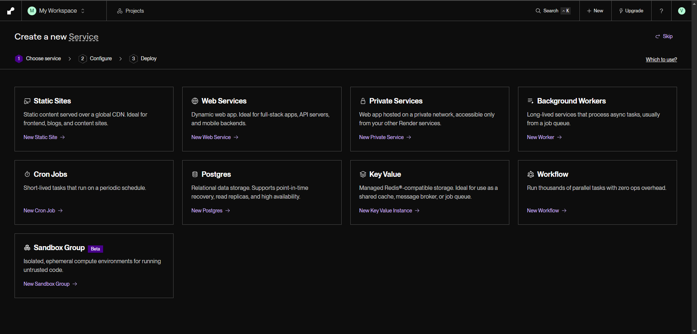

Preencha a configuração inicial:

| Campo | Preenchimento |
| --- | --- |
| Name | `espelhovital-back` ou outro nome disponível |
| Language | `Docker` |
| Branch | `main` |
| Region | Na sessão foi usado Ohio; considere a proximidade do banco |
| Root Directory | Vazio: o Dockerfile está na raiz |
| Compute | `Free`, se a proposta for usar o plano gratuito |

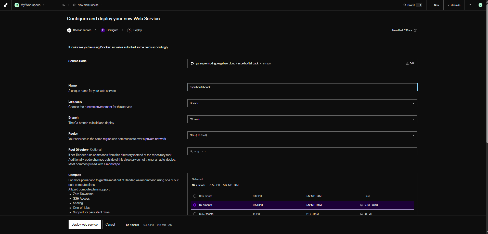

Na imagem seguinte, Free já está selecionado. Confira o valor exibido no rodapé antes de criar o serviço.

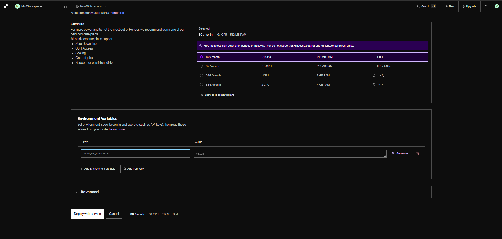

## 8. Render: cadastrar as variáveis

Em Environment Variables, use Add Environment Variable para adicionar uma por vez ou Add from .env para importar o bloco abaixo. Substitua os valores de exemplo; não cole os marcadores como se fossem credenciais reais.

```dotenv
SPRING_PROFILES_ACTIVE=prod
DB_URL=jdbc:mysql://SEU_HOST_TIDB:4000/espelhovital?sslMode=VERIFY_IDENTITY
DB_USERNAME=SEU_USUARIO_TIDB
DB_PASSWORD=SUA_SENHA_TIDB
APP_CORS_ORIGINS=https://espelhovital.vercel.app,http://localhost:5500,http://127.0.0.1:5500
APP_FRONTEND_URL=https://espelhovital.vercel.app
```

| Variável | Como preencher |
| --- | --- |
| DB_URL | URL JDBC completa: host, porta, banco e parâmetros TLS |
| DB_USERNAME | Usuário fornecido pelo TiDB; copie exatamente |
| DB_PASSWORD | Senha do banco, sem `${...}` e sem aspas adicionais |
| SPRING_PROFILES_ACTIVE | `prod`; a imagem já define esse perfil |
| APP_CORS_ORIGINS | Origens permitidas, separadas por vírgula e sem barra final |
| APP_FRONTEND_URL | Endereço público do frontend, sem `/pages/...` |

O prefixo `jdbc:mysql://` é necessário para o Java; uma URL de navegador ou apenas o hostname não substitui a URL JDBC.

Se o frontend ainda não tiver domínio, você pode iniciar com os endereços locais. Assim que publicar a Vercel, volte e adicione o domínio definitivo. Essa segunda etapa é obrigatória para o funcionamento do cadastro e login no site.

Não é necessário criar PORT manualmente no Render. A chave de IA é opcional para os fluxos de autenticação:

```dotenv
AI_API_KEY=SUA_CHAVE_GROQ
```

Para recuperação de senha por email, configure o provedor SMTP: MAIL_HOST, MAIL_PORT, MAIL_USERNAME, MAIL_PASSWORD e MAIL_FROM; ajuste MAIL_AUTH e MAIL_STARTTLS conforme esse provedor. Não considere envio de email validado sem teste de entrega. Não coloque esses segredos na Vercel nem em JavaScript público.

## 9. Render: opções Advanced

Abra Advanced e revise todos os campos antes de clicar em Deploy web service.

| Campo | Valor |
| --- | --- |
| Health Check Path | `/api/csrf` |
| Registry Credential | `No credential`, para as imagens públicas utilizadas |
| Docker Build Context Directory | `.` |
| Dockerfile Path | `./Dockerfile` |
| Docker Command | Vazio |
| Pre-Deploy Command | Vazio |
| Auto-Deploy | `On Commit` |

O ponto `.` significa a raiz do repositório, onde estão o pom.xml e o Dockerfile. Não escreva o caminho da pasta do seu Windows. As migrações do Flyway já são executadas na inicialização da aplicação; não precisamos repetir isso em Pre-Deploy Command.

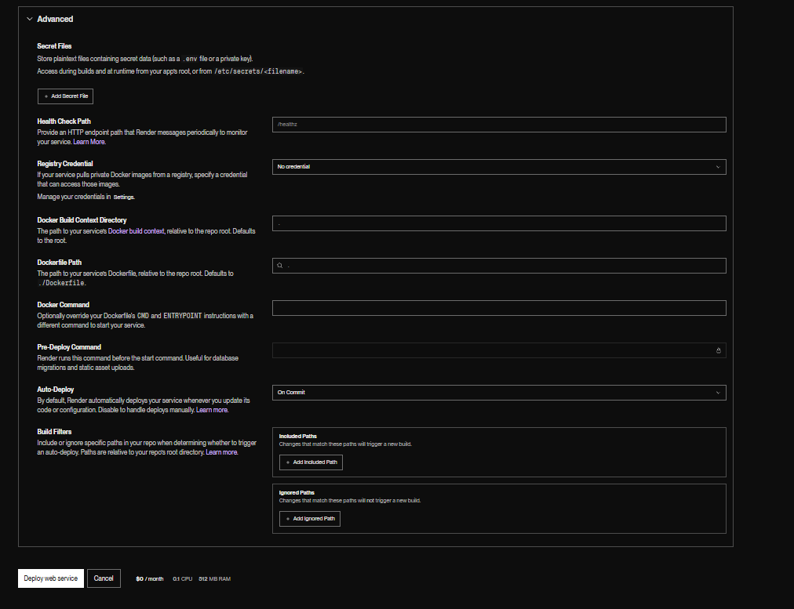

`/api/csrf` é um endpoint público existente, usado aqui como verificação HTTP. Não é um teste completo de cadastro, banco ou autorização. Ele pode criar uma sessão e retorna um token; não é necessário copiar esse token para o painel do Render.

## 10. Acompanhar o primeiro deploy

Clique em Deploy web service e acompanhe os logs. Há etapas diferentes: baixar dependências, compilar a imagem, iniciar o Java, conectar ao banco e aguardar o health check.

No primeiro deploy observado, o total foi de aproximadamente 10 minutos e 29 segundos. Isso é um registro desta execução, não uma previsão para os próximos deploys.

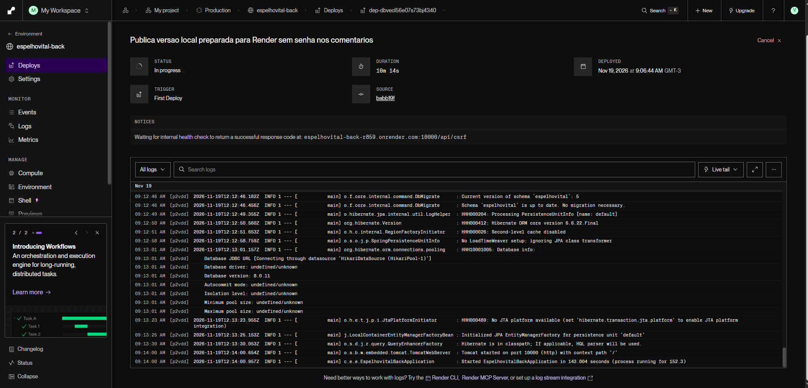

Procure mensagens equivalentes a:

```text
Current version of schema ...: 5
Schema ... is up to date. No migration necessary.
Tomcat started on port 10000 (http)
Started EspelhovitalBackApplication
Your service is live
```

O sinal de conclusão no painel é Deploy succeeded / Live.

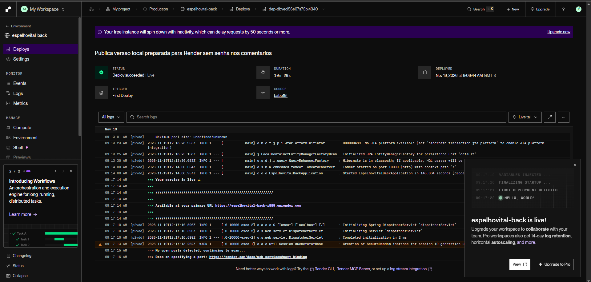

Teste no navegador:

```text
https://espelhovital-back-r859.onrender.com/api/csrf
```

A resposta esperada é HTTP 200 e JSON com token, headerName e parameterName. O valor do token é dinâmico. A raiz `/` não é uma página inicial desta API; testar somente a raiz não comprova que o backend falhou.

No plano gratuito, a instância pode parar por inatividade e demorar a responder na próxima visita. Um endpoint pendente por algum tempo não comprova, por si só, erro de banco ou senha.

## 11. Preparar o frontend para o domínio público

O projeto local usava o host da página com a porta 8081. Na Vercel, isso apontaria para uma porta onde o backend não está publicado. A configuração foi ajustada para manter o modo local e usar a origem do próprio site em produção:

```javascript
window.EV_CONFIG = {
  apiBase: ["localhost", "127.0.0.1", "[::1]"].includes(location.hostname)
    ? location.protocol + "//" + location.hostname + ":8081"
    : location.origin,
};
```

Em produção, um POST para `/usuarios/cadastrar` chega primeiro à Vercel. O `vercel.json` encaminha para o mesmo caminho no Render. O arquivo efetivo inclui todas as famílias de rotas da API, não apenas `/api`.

Exemplo reduzido, para entender o mecanismo — não substitua o arquivo completo do projeto por este trecho:

```json
{
  "rewrites": [
    {
      "source": "/api/:path*",
      "destination": "https://espelhovital-back-r859.onrender.com/api/:path*"
    },
    {
      "source": "/usuarios/:path*",
      "destination": "https://espelhovital-back-r859.onrender.com/usuarios/:path*"
    }
  ]
}
```

O arquivo completo também cobre ciclo, consultas, sono, humor, dashboard, diário, lembretes, relatórios, conta, análise de IA, recomendações e Groq. As respostas dessas rotas estão configuradas para não serem armazenadas em cache. Não encaminhe indiscriminadamente todos os arquivos do site para o backend.

O `js/api.js` busca o token em `/api/csrf`, envia o cabeçalho retornado pelo servidor e usa `credentials: "include"`. Não remova esse comportamento para contornar um erro 403.

## 12. Vercel: importar o frontend

Na página inicial da Vercel, clique em Import, ao lado de Import Project.

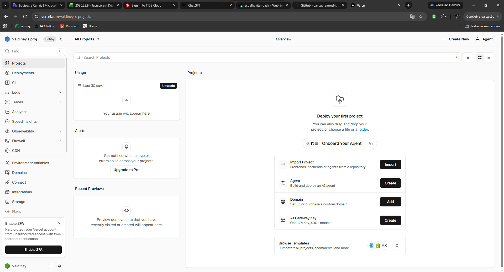

Se o repositório não aparecer, confira qual conta está selecionada no campo abaixo de Import Git Repository. A lista mostra os repositórios acessíveis pela integração, não todos os projetos do GitHub.

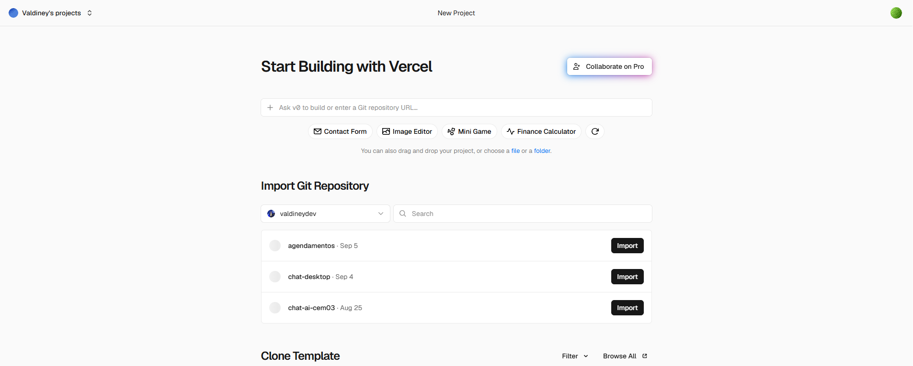

No fluxo usado nesta sessão, o repositório público original foi informado pelo endereço:

```text
https://github.com/yansupremrodriguesgalvao-cloud/EspelhoVital
```

Cole no campo superior e clique em Deploy, à direita do endereço.

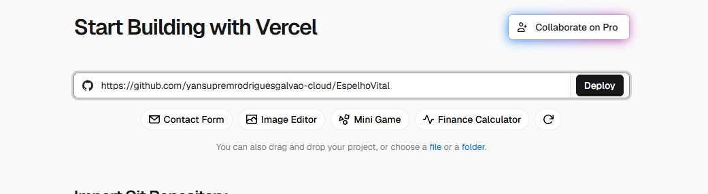

Essa ação abriu uma tela para criar uma cópia na conta conectada. Não é obrigatório criar manualmente um fork para seguir esse fluxo; a própria tela oferece criar um repositório de destino. Para integração direta com outro proprietário, é necessário ter acesso e permissões adequados na integração GitHub.

## 13. Vercel: criar a cópia e conferir o nome

Na tela New Project, confira de onde está clonando e para qual conta a cópia será criada.

| Campo | Exemplo da sessão |
| --- | --- |
| Cloning from GitHub | Repositório original EspelhoVital, branch master |
| Git Scope | `valdineydev` |
| Private Repository Name | `espelhovital`, em minúsculas |
| Vercel Team | Espaço de trabalho do professor, plano Hobby |

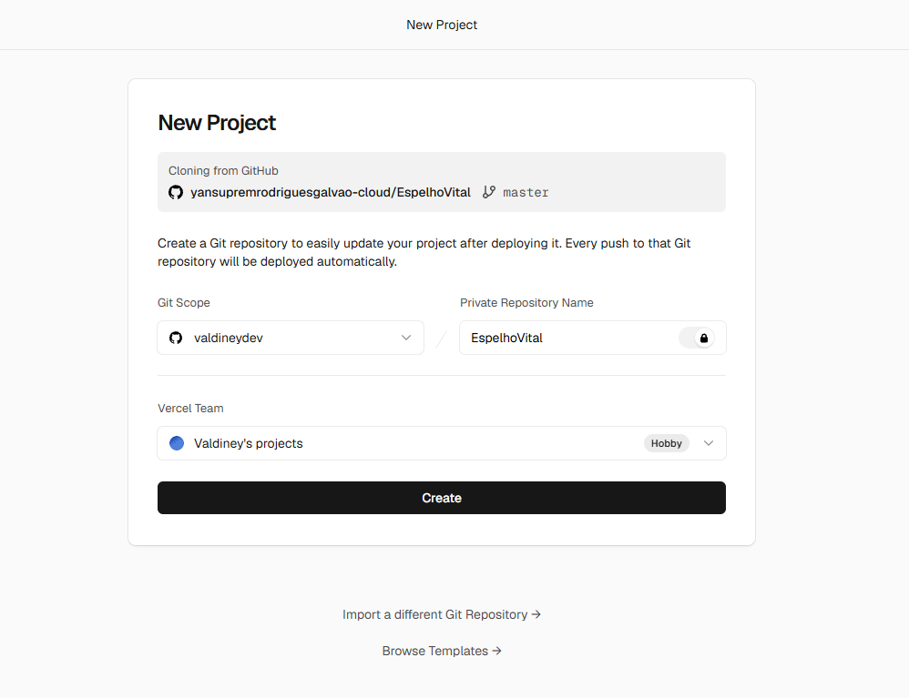

O nome inicialmente apareceu como EspelhoVital. A Vercel rejeitou as letras maiúsculas. Para este projeto, use somente `espelhovital`. Se o nome já existir, escolha outro nome disponível, como `espelhovital-aula`.

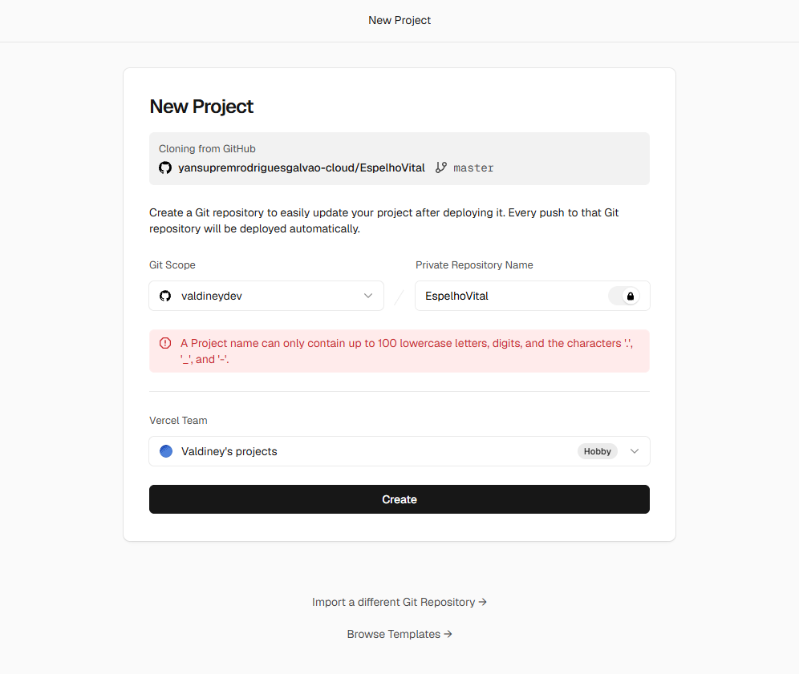

Clique em Create. Se aparecer uma etapa de configuração de build, use Framework Preset Other, raiz do projeto, sem build de framework e saída estática na raiz. O `vercel.json` já define framework nulo, buildCommand nulo, outputDirectory `.` e cleanUrls false; preserve essas configurações para manter os caminhos `.html`.

Não configure DB_PASSWORD nem AI_API_KEY no frontend. O backend é quem acessa o banco e o serviço de IA.

Depois de publicar, abra o domínio indicado pelo painel, confira Settings → Domains e anote a URL estável de produção. Confira também Settings → Git para saber o repositório e a branch conectados. Se o projeto foi copiado para outra conta, mudanças futuras no original não atualizam essa cópia automaticamente.

## 14. Etapa indispensável: autorizar a Vercel no Render

Esse foi o bloqueio observado durante o teste real. O token CSRF respondeu 200, mas o cadastro respondeu 403. A consulta de diagnóstico retornou `Invalid CORS request`, confirmando que o domínio público ainda não era aceito pelo backend.

Se o domínio de produção for `https://espelhovital.vercel.app`, use exatamente os valores abaixo. Se a Vercel atribuiu outro domínio, substitua-o em ambas as variáveis.

```dotenv
APP_CORS_ORIGINS=https://espelhovital.vercel.app,http://localhost:5500,http://127.0.0.1:5500
APP_FRONTEND_URL=https://espelhovital.vercel.app
```

Para aplicar:

1. Abra o Render e selecione o serviço espelhovital-back.
2. Clique em Environment no menu à esquerda, abaixo de Compute.
3. Na seção Environment Variables, clique em Edit, no canto superior direito.
4. Altere somente APP_CORS_ORIGINS e APP_FRONTEND_URL.
5. Preserve as variáveis do banco e o perfil prod.
6. Escolha Save and deploy, se disponível, para reaplicar a imagem com as novas variáveis. Save, rebuild, and deploy também aplica, mas recompila a imagem.
7. Não use apenas Save only esperando mudança imediata: é necessário um novo deploy para o processo receber os novos valores.
8. Aguarde Live, recarregue o cadastro e refaça o teste.

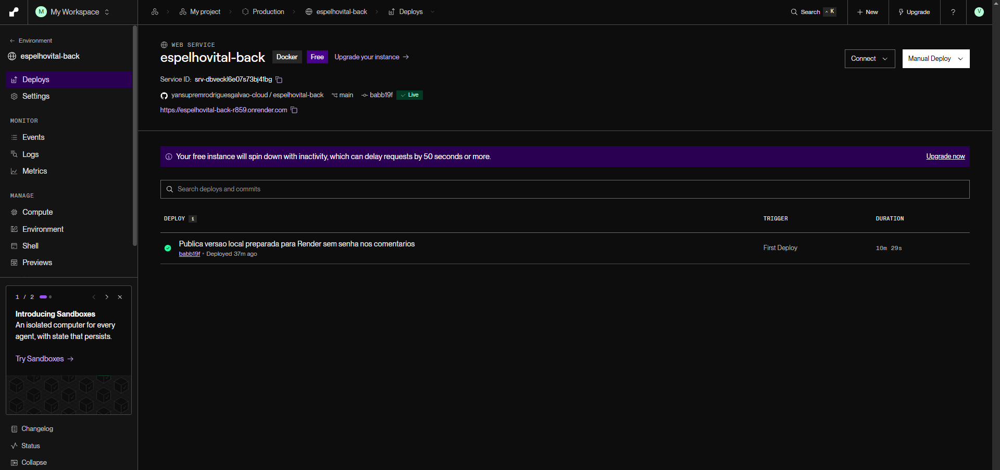

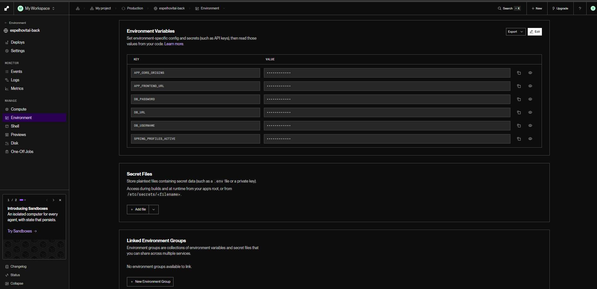

Origem inclui protocolo, host e porta quando houver. `http://localhost:5500`, `http://127.0.0.1:5500` e `https://espelhovital.vercel.app` são origens diferentes. Não adicione `/pages/cadastro.html` à lista e não use `*` em uma configuração que depende de cookies.

## 15. Testar o sistema publicado

Faça os testes pelo mesmo domínio de produção cadastrado no Render. Se usar uma URL de preview diferente, ela pode não estar autorizada.

| Teste | Procedimento | Resultado esperado |
| --- | --- | --- |
| Token | Abrir `/api/csrf` pelo domínio da Vercel | 200 e JSON, sem HTML de erro |
| Cadastro | Usar nome válido, email de teste ainda não cadastrado e senha com 8 ou mais caracteres | Mensagem de sucesso e usuário criado |
| Login | Entrar com o usuário de teste | Acesso à área autenticada |
| Persistência da sessão | Atualizar a página após entrar | Usuário continua autenticado |
| Sessão | Consultar `/api/sessao` depois do login | Perfil da conta autenticada |
| Logout | Usar o botão sair | Sessão encerrada e retorno ao login |
| Proteção | Tentar acessar recurso privado depois de sair | Requisição não autenticada recusada |
| Funcionalidades | Registrar e consultar dados de teste | Dados aparecem na conta correta |

Na aba Network, a sequência típica do cadastro é GET `/api/csrf` seguido de POST `/usuarios/cadastrar`. O login também precisa do token. A resposta do cadastro não é, por si só, uma confirmação de login automático.

Evite repetir o cadastro com o mesmo email para investigar problemas diferentes. Depois que o cadastro tiver sucesso, use esse usuário para testar o login. Não compartilhe senhas ou tokens em capturas destinadas à turma.

## 16. Diagnóstico dos erros mais comuns

| Sintoma | Causa possível ou evidência | O que conferir |
| --- | --- | --- |
| `csrf` pendente | Backend iniciando após inatividade ou problema de conexão | URL da requisição, logs e estado Live no Render |
| `csrf` 200 e cadastro 403 | CORS ou token/cookie inválido | Corpo da resposta; se Invalid CORS request, corrigir origens |
| 403 com origem já aceita | Token não enviado, sessão não preservada ou outra regra | X-CSRF-TOKEN, Cookie, Set-Cookie e credenciais da requisição |
| 400 no cadastro | Dados não atendem à validação | Corpo da resposta, nome, email e tamanho da senha |
| 401 no login | Credenciais recusadas ou usuário inexistente nesse banco | Email, senha e DB_URL do serviço |
| 404 ou HTML em `/api/csrf` na Vercel | Rewrite ausente ou deploy de repositório desatualizado | vercel.json da versão publicada e Settings → Git |
| Frontend chama porta 8081 na Vercel | config.js antigo | Versão publicada de js/config.js e cache do navegador |
| Communications link failure | Rede, host, porta, TLS ou acesso ao banco | DB_URL, regras de rede e logs do Render |
| Erro de Flyway | Histórico, checksum ou estrutura incompatível | Histórico e migrações, sem apagar dados para contornar |
| Build não encontra JAR | Caminho no Dockerfile diverge do pom.xml | Nome do artefato e versão |
| Push rejeitado com fetch first | Histórico remoto avançou | Buscar e revisar antes de integrar |
| GitHub bloqueia secret | Chave ou senha detectada até em comentário | Remover do conteúdo a publicar e configurar no ambiente |
| Mudança de ambiente não surte efeito | Foi escolhido Save only | Aplicar novo deploy e aguardar Live |
| Site não acompanha o original | A Vercel está ligada a uma cópia | Conferir Settings → Git e enviar ao repositório correto |

Não conclua que todo 403 é CORS. Nesta sessão isso foi confirmado pelo texto `Invalid CORS request`. Em outro caso, leia a resposta antes de mudar a segurança.

Para coletar evidência no Chrome: pressione F12, abra Network, ative Preserve log se necessário, repita a ação e clique na requisição. Em Headers, confira Request URL, método e status; em Response, veja o texto retornado; em Cookies, veja se houve bloqueio do cookie. Códigos 304 dos arquivos estáticos indicam uso de cache, não falha de cadastro.

## 17. Como atualizar depois e trabalhar com os alunos

Antes de cada envio, confirme a pasta, branch e destino:

```powershell
git status
git branch --show-current
git remote -v
```

Backend publicado nesta sessão: repositório espelhovital-back, branch main. Frontend original: EspelhoVital, branch master. Para o frontend efetivamente publicado, o destino deve ser o repositório mostrado em Settings → Git na Vercel.

Fluxo recomendado para a turma: mudanças em branches individuais, revisão e merge na branch de produção. Mudanças no banco devem ganhar uma nova migração. Não editar retrospectivamente uma migração executada.

Com Auto-Deploy configurado, mudanças na branch conectada podem iniciar nova publicação. Acompanhe os logs e repita os testes de cadastro, login, sessão e logout. Uma cópia Git independente precisa receber os commits; ela não sincroniza automaticamente com o repositório dos alunos.

## 18. Checklist para encerrar a publicação

- Banco acessível a partir do Render e histórico V1 a V5 íntegro.
- Backend com perfil prod e variáveis de banco corretas.
- Serviço Render em Live e `/api/csrf` respondendo 200.
- Frontend publicado com a versão que contém config.js, api.js e vercel.json atualizados.
- Repositório conectado à Vercel identificado e branch correta.
- Domínio de produção presente em APP_CORS_ORIGINS e APP_FRONTEND_URL.
- Novo deploy aplicado depois de editar as variáveis.
- Cadastro, login, atualização de página e logout testados no domínio publicado.
- IA e email testados separadamente, se essas funcionalidades forem necessárias.

No momento da elaboração, o item de correção de CORS ainda estava sendo executado no painel. Os testes finais acima são critérios de aceite, e não resultados já confirmados.

## 19. Referências e arquivos de apoio

As instruções dos painéis foram conferidas com a documentação oficial em 19/11/2026. Os valores de plano e textos dos botões nas imagens representam a interface observada nessa data.

- [Render: Docker e caminho do Dockerfile](https://render.com/docs/docker).
- [Render: variáveis e diferença entre salvar e aplicar um deploy](https://render.com/docs/configure-environment-variables).
- [Vercel: rewrites para origens externas](https://vercel.com/docs/rewrites).
- [Vercel: integração com repositórios Git](https://vercel.com/docs/git).

Arquivos relacionados: Dockerfile e DEPLOY-RENDER.md no backend; vercel.json e DEPLOY-VERCEL.md no frontend. Para imprimir este material, abra GUIA-DEPLOY.html e use o botão Imprimir / salvar em PDF. O HTML incorpora as imagens, de modo que pode ser compartilhado como um único arquivo.
